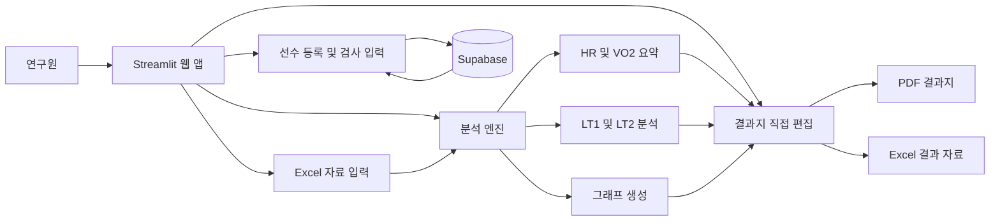

# NGC CPET

차세대스포츠과학지원센터의 운동부하검사 데이터를 정리하고, 혈중 젖산염과 LT1, LT2 분석을 포함한 선수 피드백지를 제작하는 Streamlit 웹 앱입니다.

선수 등록부터 검사 자료 입력, Excel 원자료 처리, 자동 분석, 결과지 직접 편집, PDF 및 Excel 출력까지 한 화면 흐름으로 처리할 수 있도록 구성했습니다.

## 주요 기능

- 선수 등록 및 기존 선수 불러오기
- 선수별 측정 날짜 기준 검사 기록 저장 및 재불러오기
- 신장, 체중, BMI, VO2max, HRmax, 운동 시간, 최대 부하, 경사도 입력
- 부하 단위 `Speed`와 `Power` 지원
- 일반 운동 Stage 시간을 웹에서 직접 설정
- Excel `Data` 시트 자동 처리
- Excel `Lactate` 시트 혈중 젖산염 자동 입력
- Rest가 없는 검사 허용
- Stage 사이 Rest 구간 처리
- All-Out 이후 Recovery 구간 처리
- 마지막 숫자 운동 Stage를 자동으로 All-Out으로 판단
- Stage별 HR 및 VO2 최소값, 최대값, 평균값 계산
- 심박수 Training Zone 계산
- 혈중 젖산염 변화 그래프 생성
- HR, VO2, Lactate 통합 그래프 생성
- 운동강도와 혈중 젖산염 증가 패턴을 이용한 LT1, LT2 자동 계산
- LT1, LT2 위치의 HR 자동 산출
- A4 세로 2페이지 결과지 생성
- 결과지 미리보기 안에서 평가 문구 직접 수정
- 문구 일부의 글자색, 굵게, 기울임, 밑줄 서식 적용
- PDF 결과지 및 Excel 결과 자료 저장
- Supabase를 이용한 선수 및 측정 정보 저장
- Python 3.12, 3.14 기준 자동 검사

## 웹 아키텍처



## 연구원 사용 흐름


## Excel 입력 형식

웹에서 제공하는 `Excel 입력 양식 받기` 버튼을 이용하면 작성 안내가 포함된 양식을 받을 수 있습니다.

### Data 시트

필수 열은 다음과 같습니다.

| Time | VO2/kg | Heart Rate | Stage |
|---|---:|---:|---|
| 00:00 | 12.4 | 98 | 4 |
| 00:01 | 12.8 | 99 | 4 |
| ... | ... | ... | ... |
| 03:00 | 16.1 | 115 | R |
| ... | ... | ... | ... |
| 04:00 | 19.5 | 128 | 5.5 |

`Stage`에는 실제 운동 부하값을 입력합니다.

- Speed 검사: `4`, `5.5`, `7`, `8.5` 등
- Power 검사: `100`, `150`, `200`, `250` 등
- Stage 사이 휴식: `R` 또는 `Rest`
- Recovery: `Recovery`, `Recovery 1min` 등

부하 단위는 Excel에 따로 적지 않고 웹에서 `Speed` 또는 `Power`를 선택합니다.

### Stage 시간 처리

일반 숫자 Stage는 웹에서 입력한 `일반 운동 Stage 시간`으로 그래프 시간을 자동 정규화합니다.

예를 들어 일반 Stage 시간을 5분으로 설정하면 실제 원자료가 4분 48초 또는 5분 12초 기록되어도 그래프에서는 해당 Stage를 5분으로 맞춥니다.

단, 다음 구간은 실제 기록 시간을 사용합니다.

- 마지막 숫자 Stage인 All-Out 구간
- Rest
- Recovery

### All-Out 입력 기준

Excel에는 `All-Out`이라는 글자를 따로 입력하지 않는 것을 기본 기준으로 합니다.

마지막 숫자 운동 Stage를 프로그램이 자동으로 All-Out으로 처리합니다.

예를 들어 16 km/h에서 검사가 종료되었다면:

```text
14
14
16
16
16
Recovery
```

처럼 실제 부하값 `16`을 입력합니다.

### Lactate 시트

| Stage | Lactate |
|---|---:|
| Rest | 1.19 |
| 4 | 1.02 |
| 5.5 | 1.13 |
| 7 | 1.37 |
| 8.5 | 1.91 |
| 16 | 8.67 |
| Recovery 1min | 6.20 |
| Recovery 5min | 3.10 |

운동 Stage의 숫자는 `Data` 시트와 동일하게 작성합니다.

- Rest 측정이 없으면 생략 가능
- 마지막 운동 Stage도 실제 부하값으로 입력
- Recovery 측정값이 있으면 추가 가능
- 빈 젖산값은 분석에서 제외

## LT1 및 LT2 분석

LT 분석은 고정된 특정 젖산 농도를 기준으로 정하는 방식이 아니라, 운동강도가 증가할 때 나타나는 혈중 젖산염 증가 패턴의 변화 지점을 계산하는 방식입니다.

간단히 설명하면:

1. 운동 Stage의 부하와 젖산값을 이용합니다.
2. 젖산 증가 패턴을 두 구간으로 나누어 가장 잘 맞는 두 회귀선을 찾습니다.
3. 두 회귀선이 만나는 지점을 LT1으로 계산합니다.
4. LT1 이후 구간에 같은 분석을 다시 적용해 LT2를 계산합니다.

분석 시 Rest와 Recovery는 제외하고 실제 운동 Stage를 사용합니다. 유효한 측정점이 부족하거나 계산된 역치가 측정 부하 범위를 벗어나면 `산출 불가`로 처리합니다.

## 결과지 편집

결과지 탭에서는 별도의 입력창이 아니라 실제 결과지 안의 문구를 직접 클릭해서 수정할 수 있습니다.

현재 직접 편집 가능한 영역은 다음과 같습니다.

- 1페이지 HR, VO2 그래프 아래 평가 문구
- 2페이지 Lactate 그래프 아래 평가 문구
- LT1 분석 결과 문구
- LT2 분석 결과 문구

편집 도구를 이용해 선택한 글자에 다음 서식을 적용할 수 있습니다.

- 굵게
- 기울임
- 밑줄
- 빨강
- 파랑
- 검정
- 서식 지우기

수정 내용은 PDF 결과지와 Excel 결과 자료에 반영됩니다.

## 저장 구조

선수 기본 정보와 측정 정보는 Supabase에 저장합니다.

주요 저장 항목:

- 선수 이름
- 성별
- 선수 구분
- 측정 날짜
- 신장
- 체중
- BMI
- VO2max
- HRmax
- 운동 시간
- 부하 단위
- 최대 부하
- 경사도
- 일반 운동 Stage 시간

동일 선수와 동일 측정 날짜의 기록은 기존 기록을 불러와 수정할 수 있습니다.

## 로컬 실행

Windows 기준:

```bash
python -m venv .venv
.venv\Scripts\activate
pip install -r requirements.txt
streamlit run streamlit_app.py
```

macOS 또는 Linux에서는 가상환경 활성화 명령이 다릅니다.

## Streamlit Secrets

Supabase 연결을 위해 Streamlit Secrets에 프로젝트 URL과 비밀 키를 설정해야 합니다.

예시는 `.streamlit/secrets.toml.example`을 참고합니다.

비밀 키는 GitHub 저장소에 올리지 않습니다.

## 배포

Streamlit Community Cloud에서 다음 설정으로 배포합니다.

- Repository: `Bogyeom99/ngc-cpet`
- Branch: `main`
- Main file path: `streamlit_app.py`

`packages.txt`는 PDF 출력과 한글 그래프 표시를 위해 필요한 시스템 패키지를 설치합니다.

## 자동 검사

GitHub Actions에서 다음 항목을 자동으로 확인합니다.

- Python 문법 검사
- 주요 모듈 import 검사
- Excel Stage 처리
- Speed 및 Power 처리
- Rest 없음 처리
- All-Out 자동 판단
- Recovery 처리
- LT 계산
- HR, VO2, Lactate 그래프 생성
- 결과지 HTML 생성
- Python 3.12 및 3.14 실행

## 기술 구성

- Streamlit
- Python
- pandas
- NumPy
- Matplotlib
- openpyxl
- WeasyPrint
- Supabase
- GitHub Actions
